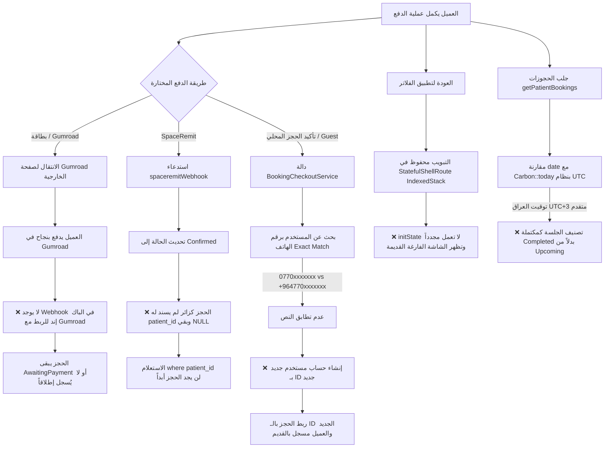

# تحليل شامل: سبب عدم ظهور الجلسة في صفحة "جلساتي" بعد إتمام الدفع
## Analysis: Why Sessions Do Not Appear in "My Sessions" Page After Payment

> **مسارات المشاريع المعنية:**
> - **الباك إند (Laravel Backend):** `D:\amir\projects\ox-tech\yonis`
> - **تطبيق الموبايل (Flutter App):** `d:\amir\projects\ox-tech\yonis-App`

---

## 1. الملخص التنفيذي (Executive Summary)

تعتمد صفحة "جلساتي" (سواء في تطبيق الهاتف أو لوحة تحكم الموقع) على استعلام مباشر في قاعدة البيانات لجلب الحجوزات المسجلة تحت معرّف المريض الحالي:
```php
Booking::where('patient_id', $user->id)
```
تم تحديد **6 أسباب رئيسية** تقف وراء اختفاء الجلسة بعد عملية الدفع، تتوزع بين منطق معالجة بوابات الدفع (Webhooks)، تطابق أرقام الهواتف وإنشاء حسابات مكررة، ضبط التوقيت في السيرفر، وطريقة تخزين الشاشات في الفلاتر (`IndexedStack`).

---

## 2. مخطط تدفق البيانات ونقاط الخلل (Workflow & Failure Points)



---

## 3. التحليل الجذري التفصيلي للأسباب (Root Cause Analysis)

### السبب الأول: الدفع عبر البطاقة (Gumroad / External Gateway) بدون Webhook
* **الملفات المعنية:**
  - الباك إند: [`app/Http/Controllers/ApiController.php`](file:///D:/amir/projects/ox-tech/yonis/app/Http/Controllers/ApiController.php) (الأسطر 895–900)
  - التطبيق: [`lib/features/booking/presentation/pages/checkout_payment_page.dart`](file:///d:/amir/projects/ox-tech/yonis-App/lib/features/booking/presentation/pages/checkout_payment_page.dart) (الأسطر 847–853)
* **الشرح التقني:**
  عند اختيار الدفع بالبطاقة، يُفتح رابط خارجي لمنصة Gumroad (`https://younisalmurshed.gumroad.com/l/srjlvw?wanted=true`).
  - منصة Gumroad نظام خارجي معزول.
  - لا يوجد في الباك إند (`routes/api.php` أو `routes/web.php`) أي مسار Webhook أو IPN مخصص لاستقبال إشعارات Gumroad وتأكيد الحجز برمجياً.
  - نتيجة لذلك: إذا أتم العميل الدفع في متصفح خارجي ولم يقم التطبيق باستدعاء أمر إتمام الحجز، فإن قاعدة البيانات لا تسجل نجاح العملية مطلقاً ويبقى الحجز `AwaitingPayment`.

---

### السبب الثاني: عدم تطابق صيغ أرقام الهواتف وإنشاء حساب مستخدم بديل (`patient_id` Mismatch)
* **الملفات المعنية:**
  - الباك إند: [`app/Services/BookingCheckoutService.php`](file:///D:/amir/projects/ox-tech/yonis/app/Services/BookingCheckoutService.php) (الأسطر 33–36)
  - الباك إند: [`app/Http/Controllers/ApiController.php`](file:///D:/amir/projects/ox-tech/yonis/app/Http/Controllers/ApiController.php) (الأسطر 1401)
* **الشرح التقني:**
  - في `BookingCheckoutService.php`، يتم فحص وجود المستخدم بالسطر التالي:
    ```php
    $existingUser = User::where('phone', $phone)->first();
    ```
    هذا البحث يعتمد على **تطابق حرفي تام (Strict Exact Match)**.
  - إذا كان العميل مسجلاً سابقاً برقم محلي مثل `07701234567`، ولكن شاشة الحجز أرسلت الرقم بالصيغة الدولية `+9647701234567`:
    1. يفشل البحث في إيجاد الحساب الحالي.
    2. يقوم السيرفر بإنشاء حساب جديد عبر `User::create(...)` برقم معرّف جديد (مثلاً ID: 25).
    3. يتم ربط الحجز بالمعرف الجديد: `booking.patient_id = 25`.
    4. تطبيق الموبايل يحتفظ برمز التوكن (Token) الخاص بالحساب الأصلي (ID: 10).
    5. عند طلب `GET /api/patient/bookings`، يستعلم السيرفر عن `patient_id = 10`، وبالتالي **لا تظهر الجلسة نهائياً** لأنها مسجلة باسم الحساب 25.

---

### السبب الثالث: بقاء `patient_id` فارغاً (`NULL`) في الـ Webhook (مثل SpaceRemit)
* **الملفات المعنية:**
  - الباك إند: [`app/Http/Controllers/BookingController.php`](file:///D:/amir/projects/ox-tech/yonis/app/Http/Controllers/BookingController.php) (الأسطر 540–585)
* **الشرح التقني:**
  - عند قيام بوابة SpaceRemit بإرسال إشعار الدفع الناجح، تقوم دالة `spaceremitWebhook` بالآتي:
    ```php
    $booking->status = 'Confirmed';
    $booking->save();
    $booking->payment->update(['status' => 'Paid']);
    ```
  - **الخلل:** إذا كان الحجز قد بدأ كحجز زائر (Guest) وخُزنت بيانات المستخدم مؤقتاً في `temp_user_data`، فإن دالة الـ Webhook لم تقم باستدعاء `confirmBookingPayment` لتحويل الزائر إلى مستخدم وتعيين `patient_id`.
  - يبقى الحقل `patient_id = NULL`.
  - استعلام لوحة المريض:
    ```php
    Booking::where('patient_id', $user->id)
    ```
    يتجاهل أي حجز فيه `patient_id` فارغ، فلا يظهر الحجز للمستخدم بالرغم من أنه `Confirmed` و `Paid`.

---

### السبب الرابع: التخزين المؤقت للشاشة في الفلاتر (`StatefulShellRoute.indexedStack`)
* **الملفات المعنية:**
  - تطبيق الفلاتر: [`lib/app/router/app_router.dart`](file:///d:/amir/projects/ox-tech/yonis-App/lib/app/router/app_router.dart) (الأسطر 137–173)
  - تطبيق الفلاتر: [`lib/features/sessions/presentation/pages/sessions_page.dart`](file:///d:/amir/projects/ox-tech/yonis-App/lib/features/sessions/presentation/pages/sessions_page.dart)
* **الشرح التقني:**
  - شاشة الجلسات موضوعة داخل فرع `StatefulShellRoute.indexedStack`.
  - ميزة `indexedStack` أنها تبقي حالة الـ Widgets حية في الذاكرة لتجنب إعادة البناء عند التنقل.
  - إذا دخل العميل على صفحة "جلساتي" قبل أن يحجز، يتم استدعاء `initState` وتُخزن الصفحة في الذاكرة بحالتها الفارغة.
  - عندما يذهب العميل ويحجز ويدفع بنجاح، ثم يعود لتبويب "جلساتي" بالنقر على الأيقونة في الشريط السفلي (Bottom Navigation Bar) وليس عبر زر الانتقال المباشر:
    - **لا يُعاد تشغيل `initState` ولا يُستدعى `load()` مجدداً**.
    - تظل الشاشة تعرض الحالة الفارغة المخزنة مؤقتاً حتى يقوم المستخدم بالسحب لأسفل لتحديث الصفحة يدوياً (Pull to Refresh).

---

### السبب الخامس: فارق التوقيت بين السيرفر (UTC) والتوقيت المحلي (العراق UTC+3)
* **الملفات المعنية:**
  - الباك إند: [`config/app.php`](file:///D:/amir/projects/ox-tech/yonis/config/app.php) (السطر 71)
  - الباك إند: [`app/Http/Controllers/ApiController.php`](file:///D:/amir/projects/ox-tech/yonis/app/Http/Controllers/ApiController.php) (الأسطر 1404–1414)
* **الشرح التقني:**
  - تم ضبط توقيت السيرفر الافتراضي على:
    ```php
    'timezone' => 'UTC',
    ```
  - بينما توقيت العراق المحلي هو `UTC+3`.
  - استعلام جلب الجلسات القادمة في الباك إند:
    ```php
    if ($tab === 'upcoming') {
        $query->whereIn('status', ['Confirmed', 'AwaitingPayment', 'PendingPaymentReview', 'Pending', 'pending', 'Rescheduled'])
              ->where('date', '>=', Carbon::today()->format('Y-m-d'));
    } elseif ($tab === 'completed') {
        $query->where(function ($q) {
            $q->where('status', 'Completed')
              ->orWhere(function ($q2) {
                  $q2->whereIn(...)
                     ->where('date', '<', Carbon::today()->format('Y-m-d'));
              });
        });
    }
    ```
  - إذا حجز العميل موعداً لليوم الحالي، وتزامن ذلك مع الساعات الأولى بعد منتصف الليل بتوقيت العراق (بين 00:00 و 03:00 ص)، فإن التاريخ على السيرفر (UTC) لا يزال تاريخ الأمس.
  - يعتبر السيرفر أن تاريخ الحجز قد مضى، ويقوم بإدراجه في تبويب **"المكتملة" (Completed)** بدلاً من **"القادمة" (Upcoming)**!
  - نظراً لأن التطبيق يفتح تلقائياً على تبويب "القادمة"، تبدو الصفحة للمستخدم وكأن الجلسة لم تُحجز.

---

### السبب السادس: الدفع اليدوي (ZainCash / SuperKi) يتطلب موافقة الأدمن
* **الملفات المعنية:**
  - الباك إند: [`app/Http/Controllers/ApiController.php`](file:///D:/amir/projects/ox-tech/yonis/app/Http/Controllers/ApiController.php) (دالة `confirmLocalPayment`)
* **الشرح التقني:**
  - عند الدفع عبر المحافظ المحلية (ZainCash أو SuperKi) ورفع إيصال التحويل، تكون حالة الحجز:
    `PendingPaymentReview` (قيد مراجعة الدفع).
  - هذا الحجز لا يُعتبر مؤكداً نهائياً حتى يقوم الطبيب أو مدير النظام بالدخول إلى لوحة تحكم الأدمن وتأكيد استلام المبلغ يدوياً وتغيير حالته إلى `Confirmed`.
  - إذا كان هناك استعلام أو فلترة في بعض أجزاء النظام تبحث حصراً عن الحجوزات ذات الحالة `Confirmed`، فلن يظهر الحجز حتى تتم المراجعة اليدوية.

---

## 4. الحلول البرمجية المقترحة (Step-by-Step Code Fixes)

### الحل 1: تصحيح مطابقة أرقام الهواتف في الباك إند
في الملف [`D:\amir\projects\ox-tech\yonis\app\Services\BookingCheckoutService.php`](file:///D:/amir/projects/ox-tech/yonis/app/Services/BookingCheckoutService.php)، استبدل البحث البسيط بالبحث الذكي الذي يطابق آخر 9 أرقام:

```php
// قبل التعديل:
// $existingUser = User::where('phone', $phone)->first();

// بعد التعديل (مطابقة ذكية تتجاهل الصفر الدولي ورموز الدول):
$existingUser = null;
if (!empty($phone)) {
    $digits = preg_replace('/\D/', '', $phone);
    $last9 = strlen($digits) >= 9 ? substr($digits, -9) : $digits;
    
    $existingUser = User::where('phone', $phone)
        ->orWhere('phone', '+' . $digits)
        ->orWhere('phone', $digits)
        ->when(strlen($last9) >= 7, function ($q) use ($last9) {
            $q->orWhere('phone', 'like', '%' . $last9);
        })
        ->first();
}
```

---

### الحل 2: ضمان إسناد `patient_id` عند تأكيد الدفع عبر Webhook
في الملف [`D:\amir\projects\ox-tech\yonis\app\Http\Controllers\BookingController.php`](file:///D:/amir/projects/ox-tech/yonis/app/Http/Controllers/BookingController.php)، داخل دالة `spaceremitWebhook`:

```php
if ($booking) {
    if ($isSuccessful) {
        // تأكد من تحويل بيانات temp_user_data إلى مستخدم حقيقي إذا لم يكن مسنداً
        if (!$booking->patient_id && !empty($booking->temp_user_data)) {
            $checkoutService = app(\App\Services\BookingCheckoutService::class);
            $payment = $booking->payment ?: \App\Models\Payment::create([
                'booking_id' => $booking->id,
                'amount' => $booking->price,
                'currency' => 'iqd',
                'status' => 'Paid',
            ]);
            $checkoutService->confirmBookingPayment($booking, $payment);
        } else {
            $booking->status = 'Confirmed';
            $booking->save();
            if ($booking->payment) {
                $booking->payment->update(['status' => 'Paid']);
            }
        }

        Log::info("SpaceRemit Webhook: Booking {$booking->booking_reference} confirmed and patient assigned.");
    }
}
```

---

### الحل 3: ضبط المنطقة الزمنية للباك إند (Timezone)
في الملف [`D:\amir\projects\ox-tech\yonis\config\app.php`](file:///D:/amir/projects/ox-tech/yonis/config/app.php):
```php
// تغيير التوقيت ليتوافق مع توقيت العيادة والعملاء في العراق:
'timezone' => env('APP_TIMEZONE', 'Asia/Baghdad'),
```
وفي ملف `.env`:
```env
APP_TIMEZONE=Asia/Baghdad
```

---

### الحل 4: تحديث تبويب الجلسات تلقائياً في فلاتر عند العودة إليه
في الملف [`d:\amir\projects\ox-tech\yonis-App\lib\features\sessions\presentation\pages\sessions_page.dart`](file:///d:/amir/projects/ox-tech/yonis-App/lib/features/sessions/presentation/pages/sessions_page.dart):

تفعيل الاستماع لدورة حياة الشاشة أو استخدام `RouteAware` أو فحص التحديث عند إعادة بناء الشاشة:
```dart
// في دالة didChangeDependencies أو عند التبديل للتبويب:
@override
void didChangeDependencies() {
  super.didChangeDependencies();
  // التأكد من جلب أحدث الحجوزات عند التركيز على الشاشة
  if (AuthState.instance.isLoggedIn && !_checkingAuth) {
    context.read<SessionsCubit>().load();
  }
}
```

---

## 5. جدول ملخص للتحقق السريع (Troubleshooting Checklist)

| الاحتمال | كيف تفحصه؟ | طريقة العلاج |
| :--- | :--- | :--- |
| **الدفع عبر Gumroad** | افحص حالة الحجز في جدول `bookings` | ربط بوابة الدفع برابط Webhook يرسل إشعاراً لـ `/api/payment/...` |
| **تكرار الحسابات برقمين مختلفين** | افحص جدول `users` لمعرفة إن كان هناك مستخدمان لنفس الشخص | تطبيق مطابقة الأرقام في `BookingCheckoutService` |
| **`patient_id` فارغ (NULL)** | استعلم في قاعدة البيانات: `SELECT * FROM bookings WHERE patient_id IS NULL` | استدعاء `confirmBookingPayment` داخل الـ Webhooks |
| **الحجز ذهب لتبويب "المكتملة"** | افتح تبويب "المكتملة" في التطبيق | ضبط `APP_TIMEZONE=Asia/Baghdad` في `.env` |
| **كاش التطبيق في فلاتر** | اسحب الشاشة لأسفل في تبويب الجلسات (Pull to Refresh) | تحديث الـ Cubit برمجياً عند تفعيل التبويب |
